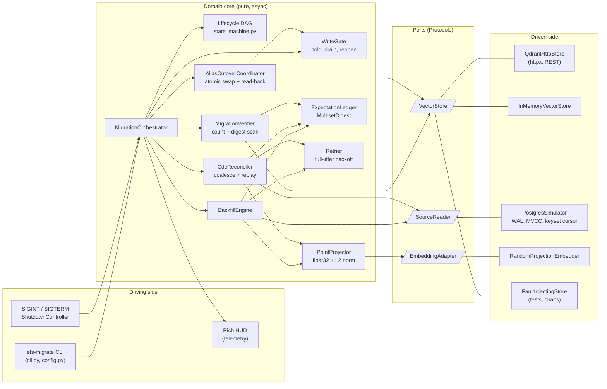
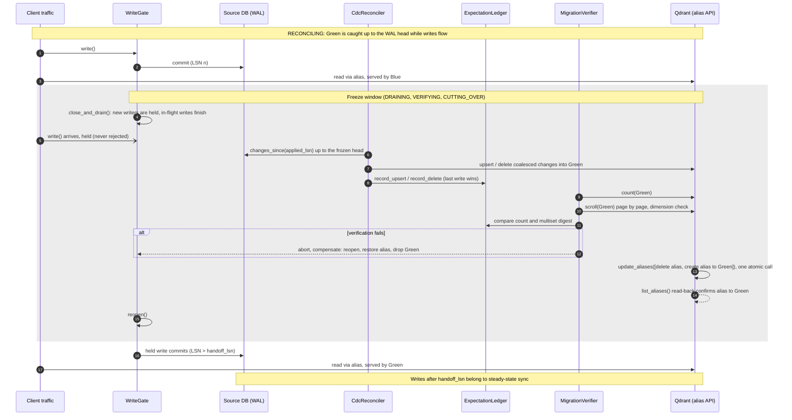
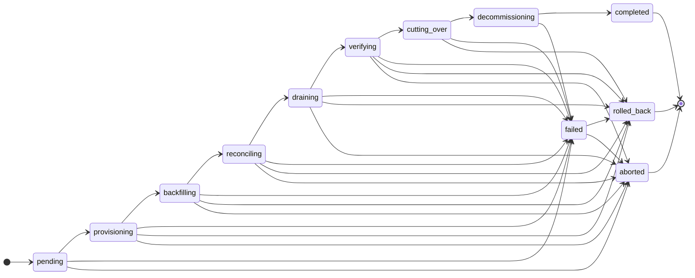

# embedding-feature-store

**L8+ carrier-grade blue/green vector migration engine.** Re-embeds a live
feature table into a new vector collection, verifies it, and moves serving traffic
over with one atomic alias swap: no read downtime, no lost writes, and a full
compensating rollback on any failure before the point of no return.

[](../../actions/workflows/ci.yml)
[](pyproject.toml)
[](#quality-gates)
[](pyproject.toml)
[](scripts/mutate.sh)
[](tests/test_network_barrier.py)
[](Dockerfile)

---

## Contents

- [What it does](#what-it-does)
- [Architecture](#architecture)
- [The freeze window](#the-freeze-window)
- [Lifecycle state machine](#lifecycle-state-machine)
- [Guarantees and invariants](#guarantees-and-invariants)
- [Benchmarks](#benchmarks)
- [Quality gates](#quality-gates)
- [Quickstart](#quickstart)
- [CLI reference](#cli-reference)
- [Containers and Compose](#containers-and-compose)
- [Development](#development)
- [Limitations](#limitations)

## What it does

A serving alias (`features_active`) points at the **Blue** collection. A
migration to a new embedding model (different dimension, distance or model
version) runs while reads and writes continue:

1. **Provision** the **Green** collection with the target vector spec.
2. **Backfill** Green from a consistent MVCC snapshot of the source table,
   streamed through a bounded keyset cursor (backpressure, constant memory per page).
3. **Reconcile** every change committed since the snapshot by replaying the
   CDC log (write-ahead log) from the snapshot LSN.
4. **Freeze** writes, replay the last CDC events, **verify** Green against an
   independently maintained expectation ledger, **swap** the alias atomically,
   and reopen writes.
5. **Decommission** Blue.

Any failure before the swap compensates: writes reopen, the alias is restored to
its original binding, and Green is dropped. The result is printed as one JSON
line on stdout, with an exit code that scripts can rely on.

## Architecture

Hexagonal: the domain core depends only on ports (`typing.Protocol`); adapters
plug in at the composition root ([`pipeline/cli.py`](src/embedding_feature_store/pipeline/cli.py)).



| Package | Responsibility |
|---|---|
| [`schemas.py`](src/embedding_feature_store/schemas.py) | Frozen, strict Pydantic v2 contracts. NaN/Inf rejected, vectors canonicalised to float32, canonical point identity (SHA-256). |
| [`core/`](src/embedding_feature_store/core) | Ports, error taxonomy (transient vs permanent), lifecycle DAG, retry, write gate, projection, cutover, verification. |
| [`storage/`](src/embedding_feature_store/storage) | Qdrant REST adapter, in-memory store, PostgreSQL simulator, bounded async streams, fault injection. |
| [`pipeline/`](src/embedding_feature_store/pipeline) | Orchestrator, backfill, CDC reconcile, bootstrap, live-traffic simulator, signal handling, CLI. |
| [`telemetry/`](src/embedding_feature_store/telemetry) | Single-writer metrics registry and the Rich terminal HUD (stderr only). |

## The freeze window

Client **writes go to the source database through the `WriteGate`**; client
**reads go to the serving alias**. CDC carries writes into Green, so Green is
complete only once the gate is closed and the log is drained to its head. The
freeze spans the drain, the final CDC replay, verification and the alias swap.



`drain_ms` in the JSON summary is step 4 alone; `cutover_ms` is the alias swap
plus read-back. The whole freeze window is measured in [Benchmarks](#benchmarks).

## Lifecycle state machine

A pure, table-driven DAG ([`core/state_machine.py`](src/embedding_feature_store/core/state_machine.py)).
Every transition returns a new validated `MigrationState` with an append-only
history; anything not drawn here raises `IllegalTransitionError`.



- `failed` is not terminal: it must resolve to `rolled_back` or `aborted`.
- **Point of no return:** once `decommissioning` has begun, Blue may be gone,
  so `failed --> rolled_back` is refused for any state whose history contains
  `decommissioning`. A failed decommission ends `aborted`, with traffic still on
  the verified Green collection.
- `aborted` means the run stopped short of completion. That happens when a
  shutdown signal arrives (after compensating), when compensation itself fails,
  or when decommissioning fails. It is entered directly only before the alias is
  touched, and otherwise through `failed`.

## Guarantees and invariants

**Zero dropped writes.** `WriteGate.write()` never rejects: while the gate is
closed, writers wait on an `asyncio.Event` and proceed after `reopen()`.
`close_and_drain()` waits until in-flight writes reach zero. If that exceeds
`--drain-timeout`, it reopens the gate itself before raising, so a failed freeze
never strands writers. The gate is reopened on every orchestrator exit path,
including unexpected exceptions. Held writes commit after the swap at an LSN
above the reported `handoff_lsn`.

**Two-tier verification.** Green must match an `ExpectationLedger` fed with
every upsert and delete the migration applied (last write per point id wins),
so the check does not trust the store and does not re-read the source:

| Tier | Check | Catches |
|---|---|---|
| 1. Cardinality | `count(Green) == ledger.count` | lost or duplicated points |
| 2. Content | Scroll every point, enforce the target dimension, fold each point's canonical identity into a `MultisetDigest` and compare with the ledger's | wrong vectors, payloads, ids or dimensions at equal count |

A point's canonical identity is SHA-256 over a canonical, type-aware encoding
of its id, float32 little-endian vector bytes and sorted payload (`1`, `1.0`,
`True` and `"1"` all differ). The `MultisetDigest` sums element hashes modulo
2^256, so it is independent of scroll order and supports removal. It is an
integrity check against accidental divergence, not a commitment against an
adversary.

**Atomic cutover.** The alias moves in a single `update_aliases` call
(delete + create), confirmed by reading the aliases back. A swap that failed
ambiguously is resolved by that read-back; a partial swap is restored to the
previous binding inside the freeze.

**Compensation.** Before the swap, any `FeatureStoreError`, failed verification
or shutdown signal reopens writes, rebinds the alias to what it pointed at when
the run started, and drops Green, but only if this run created it. If
compensation itself fails, the run reports `aborted`, never a clean
`rolled_back`.

**Signals.** The first SIGINT/SIGTERM aborts cooperatively at the next batch or
phase boundary and compensates (exit 130/143). From the alias swap onward the
run is in a critical section: signals are recorded but not acted on, so the swap
and decommission complete and the run exits normally.

**Exit codes.** `0` completed · `1` failed, rolled back or aborted · `2` usage
or configuration error · `128 + signum` aborted by a signal.

## Benchmarks

Measured with [`scripts/benchmark.py`](scripts/benchmark.py), which runs the
real `efs-migrate` entry point in a fresh child process per run, with live read
and write traffic on. Each row is the **median of 3 runs**; live-write counts
are totals over the 3 runs. Every run passed both verification tiers.

Environment: Apple M4 (10 cores), 16 GB RAM, macOS 27.2, CPython 3.12.13. Source
rows are 16-d Gaussian features, Blue is 8-d and Green is 32-d (cosine), with
batch size 256. Measured at commit `c756596`.

**Columns**

- **Throughput:** points backfilled ÷ migration wall time, where migration is
  `MigrationOrchestrator.run` end to end: provision, backfill and embed, CDC,
  freeze, verification, swap and decommission.
- **Freeze window:** gate closed until reopened.
- **Drain:** waiting for in-flight writes to finish.
- **Alias swap:** the atomic swap plus its read-back confirmation.
- **Peak RSS:** of the migrator process.

### In-process store

```sh
uv run python scripts/benchmark.py --rows 1000 10000 50000 100000 --repeat 3
```

| Backend | Rows | Throughput (pts/s) | Migration (s) | Freeze window (ms) | Drain (ms) | Alias swap (ms) | Peak RSS (MiB) | Live writes / held / dropped | Read errors | Verified |
|---|--:|--:|--:|--:|--:|--:|--:|--:|--:|:-:|
| in-memory | 1,000 | 46,531 | 0.021 | 3.4 | 0.008 | 0.016 | 51 | 9 / 0 / 0 | 0 | 3/3 |
| in-memory | 10,000 | 50,737 | 0.197 | 41.8 | 0.010 | 0.026 | 98 | 63 / 0 / 0 | 0 | 3/3 |
| in-memory | 50,000 | 38,959 | 1.283 | 345.5 | 0.011 | 0.022 | 312 | 297 / 0 / 0 | 0 | 3/3 |
| in-memory | 100,000 | 25,524 | 3.918 | 1,360.2 | 0.012 | 0.033 | 580 | 591 / 0 / 0 | 0 | 3/3 |

### Real Qdrant 1.13.6

Qdrant ran from [`compose.yaml`](compose.yaml) in a Colima VM (2 vCPU, 4 GiB)
and was reached over its `127.0.0.1:6333` port forward:

```sh
docker compose up -d --wait qdrant
uv run python scripts/benchmark.py --rows 1000 10000 50000 --repeat 3 --qdrant-url http://127.0.0.1:6333
docker compose down
```

| Backend | Rows | Throughput (pts/s) | Migration (s) | Freeze window (ms) | Drain (ms) | Alias swap (ms) | Peak RSS (MiB) | Live writes / held / dropped | Read errors | Verified |
|---|--:|--:|--:|--:|--:|--:|--:|--:|--:|:-:|
| Qdrant 1.13.6 | 1,000 | 14,816 | 0.067 | 23.4 | 0.008 | 1.624 | 57 | 34 / 3 / 0 | 0 | 3/3 |
| Qdrant 1.13.6 | 10,000 | 18,810 | 0.532 | 190.3 | 0.009 | 2.019 | 75 | 205 / 3 / 0 | 0 | 3/3 |
| Qdrant 1.13.6 | 50,000 | 18,701 | 2.674 | 937.8 | 0.010 | 1.618 | 157 | 1,040 / 3 / 0 | 0 | 3/3 |

### Container memory footprint

The [`Dockerfile`](Dockerfile) image on the in-process store, hardened as in
production (read-only root, non-root, no capabilities, no network). Peak memory
is read from the container's own cgroup (`/sys/fs/cgroup/memory.peak`); each
value is the median of 3 runs.

| Rows | Container peak memory (MiB) | Verified |
|--:|--:|:-:|
| 1,000 | 35.0 | 3/3 |
| 10,000 | 80.2 | 3/3 |
| 50,000 | 292.6 | 3/3 |

The image is 52 MB compressed and 241 MB unpacked. Of that, the application's
virtualenv is 28 MB; the rest is the `python:3.12-slim` base.

### Reading the numbers

- **Zero lost writes.** Across all 21 runs, 2,239 live writes were attempted and
  none were dropped; reads through the alias never failed, including across the
  swap.
- **Held writes.** The simulator has one sequential writer, so at most one
  write can be parked at the closed gate per freeze. Against Qdrant this happens
  in every run (3 held per 3 runs): the write waits out the freeze and commits
  after reopen. On the in-process store, the verification scan rarely yields to
  the event loop, so the co-scheduled writer is not even scheduled during the
  freeze (0 held). That shows nothing is lost; the Qdrant runs show the holding
  itself.
- **The freeze window grows with collection size**, because the full tier-2
  scan runs inside it: that buys an exact, race-free verdict at the cost of
  freeze time (about 19 µs per point against Qdrant here). The alias swap itself
  stays near 2 ms.
- **The live traffic is a correctness probe, not a load test.** It runs in the
  migrator's own event loop at a 2 ms cadence.
- **Peak RSS on the in-process store** includes both collections held in
  memory. Against Qdrant it is the migrator alone.

## Quality gates

All of these are enforced by [CI](.github/workflows/ci.yml): six independent
jobs on every push and pull request to `main`.

| Gate | Result | Where |
|---|---|---|
| Tests | 703 passing, offline | `uv run pytest` |
| Coverage | 100.00%: 2,199/2,199 lines, 364/364 branches (CI re-checks with no rounding) | [`pyproject.toml`](pyproject.toml) |
| Types | `mypy --strict` clean on `src/` and `tests/` (58 files) | [`pyproject.toml`](pyproject.toml) |
| Lint / format | ruff (broad rule set) | [`pyproject.toml`](pyproject.toml) |
| Property fuzzing | Hypothesis: float32 IEEE-754 boundaries, identity hashing, multiset digest, keyset paging, WAL replay | [`tests/test_properties.py`](tests/test_properties.py) |
| Mutation testing | 236/236 mutants detected (100%) in `state_machine`, `retry`, `write_gate` and `projection`; the gate is > 90% | [`scripts/mutate.sh`](scripts/mutate.sh) |
| Network barrier | AF_INET/AF_INET6 sockets and DNS blocked; only AF_UNIX socketpairs (event loops) allowed | [`tests/test_network_barrier.py`](tests/test_network_barrier.py) |
| Chaos | Seeded fault injection: rate limits, timeouts, ambiguous timeouts | [`tests/test_orchestrator.py`](tests/test_orchestrator.py) |
| Identity | Sole committer, zero commit trailers, full history | [`scripts/audit_identity.sh`](scripts/audit_identity.sh) |
| Hygiene | No absolute host paths, every cache under `./.cache/`, images pinned by digest | [`scripts/audit_hygiene.sh`](scripts/audit_hygiene.sh) |
| Reproducible image | Two cold builds give an identical OCI tarball and manifest digest | [`scripts/verify_reproducible_image.sh`](scripts/verify_reproducible_image.sh) |

## Quickstart

Requires uv (0.11.7 is pinned in CI and the
image). All tool caches stay inside the project, under `./.cache/`.

```sh
uv sync --frozen                 # Python 3.12 venv from uv.lock
uv run efs-migrate --help
uv run efs-migrate               # demo on the in-process store, HUD on a TTY
uv run efs-migrate --no-hud --rows 10000 --report .cache/run.json
```

Against a real Qdrant:

```sh
docker compose up -d --wait qdrant
uv run efs-migrate --qdrant-url http://127.0.0.1:6333 --no-hud
docker compose down
```

stdout carries exactly one JSON line; logs and the HUD go to stderr:

```json
{"status": "completed", "exit_code": 0, "alias": "features_active", "alias_bound_to": "features_green",
 "rows_backfilled": 1999, "handoff_lsn": 2020, "drain_ms": 0.010, "cutover_ms": 1.19,
 "verification": {"passed": true, "source_count": 1994, "target_count": 1994, "source_checksum": "6c0e…", "target_checksum": "6c0e…"},
 "live_traffic": {"reads": 3, "read_errors": 0, "writes": 21, "writes_held": 1, "write_errors": 0, "dropped_writes": 0},
 "signals": [], "error": null}
```

(Abridged: the summary also includes `migration_id`, the source and target
collections, `target_dimension`, `cdc_events` and `elapsed_s`.)

## CLI reference

Every option can also be set as `EFS_<OPTION>` in the environment
(for example `EFS_QDRANT_URL`, `EFS_BATCH_SIZE`, `EFS_QDRANT_API_KEY`). Flags
take precedence. Secrets never appear in logs or the summary.

| Option | Default | Meaning |
|---|---|---|
| `--qdrant-url URL` | in-process store | Qdrant base URL; selects the Qdrant backend |
| `--qdrant-timeout S` | `10` | per-request timeout |
| `--migration-id ID` | `efs-local` | run identifier |
| `--alias NAME` | `features_active` | serving alias |
| `--blue NAME` / `--green NAME` | `features_blue` / `features_green` | source and target collections (must differ) |
| `--rows N` | `2000` | rows in the simulated source table |
| `--source-dim` / `--blue-dim` / `--green-dim` | `16` / `8` / `32` | feature and embedding dimensions |
| `--distance` | `cosine` | `cosine`, `dot` or `euclid` (target collection) |
| `--batch-size N` | `256` | backfill page size (1–10,000) |
| `--queue-capacity N` | `4` | bounded cursor queue depth (backpressure) |
| `--cdc-page-size N` | `512` | WAL events per catch-up page |
| `--retries N` | `5` | attempts per idempotent store call |
| `--drain-timeout S` | `10` | maximum wait for in-flight writes at freeze |
| `--seed N` | `0` | seeds data, embedder, retry jitter and traffic |
| `--live-traffic` / `--no-live-traffic` | on | concurrent read/write probe |
| `--hud` / `--no-hud` | auto (TTY) | Rich terminal HUD on stderr |
| `--report PATH` | none | write the summary plus the phase timeline as JSON |
| `--log-level` | `INFO` | `DEBUG`, `INFO`, `WARNING` or `ERROR` |

Also available as `python -m embedding_feature_store`.

## Containers and Compose

The [`Dockerfile`](Dockerfile) is a multi-stage build:

- **Pinned inputs:** the frontend, the `python:3.12-slim` base and uv are pinned
  by sha256 digest, and dependencies are installed from `uv.lock` with
  `--require-hashes`.
- **Reproducible output:** bytecode is compiled in checked-hash mode, every
  timestamp is clamped to `SOURCE_DATE_EPOCH`, and the user is created without
  `useradd` (which would date-stamp `/etc/shadow`).
- **Runtime:** runs as UID/GID `10001:10001` on a read-only root filesystem,
  with entrypoint `efs-migrate`.

```sh
# Bit-for-bit reproducibility proof: two --no-cache builds, compared byte for byte.
sh scripts/verify_reproducible_image.sh

# Real Qdrant (digest-pinned, unprivileged, tmpfs storage) plus one migrator run.
SOURCE_DATE_EPOCH="$(git log -1 --format=%ct)" \
  docker compose up --build --abort-on-container-exit --exit-code-from migrator
docker compose down
```

Both Compose services run `read_only`, with `no-new-privileges` and all
capabilities dropped, and mount nothing from the host. Qdrant is published only
on `127.0.0.1:6333`, with telemetry off and a `/readyz` healthcheck; the
migrator starts once it is healthy.

Compose cannot pass BuildKit's `rewrite-timestamp` exporter option, so the
byte-identical artefact is the one produced by the script above. At commit
`12e39a4` both cold builds produced manifest `sha256:774a232e…` (the digest
follows `SOURCE_DATE_EPOCH`, so it changes per commit).

## Development

```sh
uv run ruff check . && uv run ruff format --check .
uv run mypy --strict
uv run pytest                          # 100% line+branch gate, sockets disabled
HYPOTHESIS_PROFILE=ci uv run pytest    # 500 derandomised examples per property
sh scripts/mutate.sh                   # mutation testing in ./.cache/mutmut/
sh scripts/audit_identity.sh
sh scripts/audit_hygiene.sh --workspace
```

Layout:

```text
src/embedding_feature_store/   package (schemas, core, storage, pipeline, telemetry)
tests/                         unit, property, chaos, CLI and network-barrier suites
scripts/                       audits, mutation, reproducibility and benchmark tooling
Dockerfile  compose.yaml       container image and local Qdrant stack
.github/workflows/ci.yml       the six CI jobs
```

## Limitations

- **The source is a PostgreSQL simulator** (WAL, MVCC snapshots, keyset cursor
  issuing parameterised SQL); there is no adapter for a live PostgreSQL yet.
- **The embedder is a seeded random projection,** a deterministic stand-in
  behind the `EmbeddingAdapter` port, not a learned model.
- **Verification runs inside the freeze,** so the freeze grows with collection
  size (see [Benchmarks](#benchmarks)). Verifying most of the data before the
  freeze and only the changes inside it would shorten the freeze.
- **The live-traffic probe shares the migrator's event loop,** so it proves
  correctness under concurrency, not behaviour under external load.
- **Cosine collections:** Qdrant re-normalises cosine vectors on write. The
  checksum round-trip passed in every Qdrant 1.13.6 run above. That is
  empirical evidence for these datasets, not a proof for all inputs.
